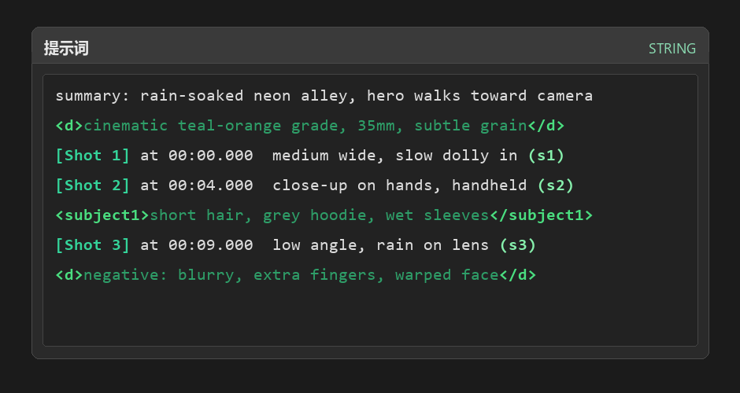

# ComfyUI Prompt Syntax Highlight

[](LICENSE)
[](https://github.com/comfyanonymous/ComfyUI)

Colour your prompt structure. This extension highlights `[Shot 1]`, `<d>...</d>`, `(s1)` and any
marker you define, **inside any prompt text box in ComfyUI** — the editable multiline STRING widget
as well as read-only *Show Text* boxes.



*Rendered illustration of the highlight rules (same palette as the CSS, not a screenshot).*

---

## Why

Long structured prompts (shot lists, `subject_definitions` blocks, negative sections) are hard to
scan when everything is one colour. Wrapping markers in colour makes shot boundaries and tagged
sections visible at a glance while you type, without changing what actually reaches the model.

- **Zero changes to the prompt.** It is a visual overlay only. The text that gets encoded is
  byte-for-byte what you typed.
- **Works on other people's nodes.** It hooks multi-line `textarea` elements, so third-party text
  nodes get highlighted too.
- **No nodes, no dependencies, no Python.** Delete the folder and every trace is gone.

## Features

| | |
|---|---|
| Editable prompt boxes | Highlights while you type, caret / selection / undo unaffected |
| Read-only text boxes | Same rules, no editing required (e.g. Show Text) |
| Tagged content | Content wrapped by a paired tag is tinted as a block |
| Canvas zoom & drag | The overlay follows the box every frame, including `transform: scale` |
| Chinese IME | Composition is never obscured — native text returns during composition |
| Configurable | Rule list is a small array at the top of one JS file |
| Toggles | Master switch plus separate switches for editable / read-only boxes |

## Install

**ComfyUI Manager** — search for `Prompt Syntax Highlight` and install.

**comfy-cli**

```bash
comfy node install comfyui-prompt-syntax-highlight
```

**Manual**

```bash
cd ComfyUI/custom_nodes
git clone https://github.com/matrixnio/ComfyUI-PromptSyntaxHighlight.git
```

Restart ComfyUI. After that, editing only the JS needs no restart — just a hard refresh
(`Ctrl+F5`), because the browser caches extension files.

To uninstall, delete the folder and restart ComfyUI.

## Usage

Open any workflow with a prompt box and type. Default rules:

```text
summary: rain-soaked neon alley, hero walks toward camera     <- plain text, unchanged
<d>cinematic teal-orange grade, 35mm, subtle grain</d>        <- tag: bright green bold, body: dark green
[Shot 1] at 00:00.000  medium wide, slow dolly in (s1)        <- bracket: teal bold, (s1): light green bold
```

Settings → search `Prompt highlight` (or `提示词高亮`):

| Setting | Default | Effect |
|---|---|---|
| `PHL.Enabled` | on | Master switch |
| `PHL.Editable` | on | Apply to editable prompt boxes |
| `PHL.Readonly` | on | Apply to read-only display boxes |

Automatically skipped: single-line inputs, disabled elements, and boxes whose placeholder contains
`search` / `filter` / `搜索` / `查找`.

## Rules

Rules live in the `RULES` array at the top of [`web/prompt_syntax_highlight.js`](web/prompt_syntax_highlight.js).
Order is priority — later rules overwrite overlapping earlier ones.

| Priority | Match | Example | Colour |
|---|---|---|---|
| 1 (lowest) | content between a paired tag | `good sad reminder` | `#2e9e68` dark green |
| 2 | the tag itself | `<d> </d> <subject1> <picture 1a>` | `#4ade80` bright green, bold |
| 3 | square brackets | `[Shot 1] [Shot 2]` | `#34d399` teal, bold |
| 4 (highest) | parenthesised indices | `(s1) (s2) (shot 3)` | `#86efac` light green, bold |

Add a rule:

```js
{ id: 5, re: /【[^】\n]{1,40}】/g },   // CJK lenticular brackets
```

then add the class name to `CLS_NAME` (`5: "phl-bracket"` reuses an existing colour) or define a new
one in `CSS`.

> Want *only the symbols* coloured and the wrapped content left alone? Delete rule `1`
> (the one with `group: 2`).

## How it works

1. The original textarea is left untouched — typing, caret, selection, copy, undo and scrolling all
   still happen there.
2. A `position: fixed` `<pre>` mirror is stacked above it and filled with colour `<span>`s.
3. The textarea's own text is made transparent (`color` + `-webkit-text-fill-color`), while
   `caret-color` keeps the caret visible.
4. Every frame the mirror re-reads `getBoundingClientRect()` and follows the box; the zoom ratio is
   computed as `rect.width / offsetWidth`, so canvas scaling stays pixel-aligned.
5. Font metrics are copied from computed style, sampled once every 15 frames.
6. During IME composition the mirror hides and the native text returns.

**Safety valves:** the native text only goes transparent after the mirror has painted *and* been
positioned; it is restored immediately when the box is covered by a modal or scrolled out of view;
any parse error falls back to plain text. The box can never end up blank.

## Compatibility

- ComfyUI **≥ 0.3.0** (tested on 0.3.x, Windows, Chrome/Edge). No Python dependency.
- Uses only public extension APIs: `app.registerExtension`, `app.ui.settings.addSetting`,
  `WEB_DIRECTORY`. It does not patch other extensions.
- Nodes 2.0 (experimental) changes the DOM; scanning is done both through the graph object and a DOM
  fallback, but that mode is not covered by tests yet.

## Troubleshooting

```bash
curl http://127.0.0.1:8188/prompt_syntax_highlight/status
```

```json
{"version": "1.0.0", "hits": 6, "targets": 4, "painted": 4, "last_error": ""}
```

| Symptom | Meaning | Fix |
|---|---|---|
| `hits` = 0 | the front-end never ran | ComfyUI not restarted, or cached JS — hard refresh |
| `hits` > 0, `targets` = 0 | no textarea found | no multiline text node on the canvas, or it is collapsed |
| `targets` > 0, `painted` = 0 | render failed | check `last_error` |
| text disappeared | mirror not tracking | reload; if it repeats, report `last_error` |

A `last_error` such as `ta=3 ro=false h=120` is a diagnostic string emitted when nothing could be
taken over (it reports how many textareas existed and their properties).

## Privacy

Everything happens in your browser. Prompt text never leaves the page: the only network calls are
`POST /prompt_syntax_highlight/ping` and `/report`, which send a count of tracked/painted boxes and,
on failure, a short diagnostic string. Telemetry can be ignored or removed — the extension works
without the backend routes.

## Disclaimer

This is an independent, community-made extension. It is **not** affiliated with, endorsed by, or
sponsored by Comfy Org or the ComfyUI project. "ComfyUI" is used descriptively to indicate
compatibility, as is customary for custom-node repositories.

## License

[MIT](LICENSE) © 2026 matrixnio
